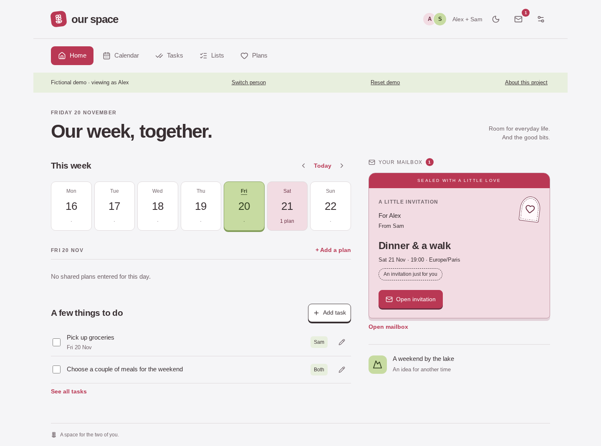
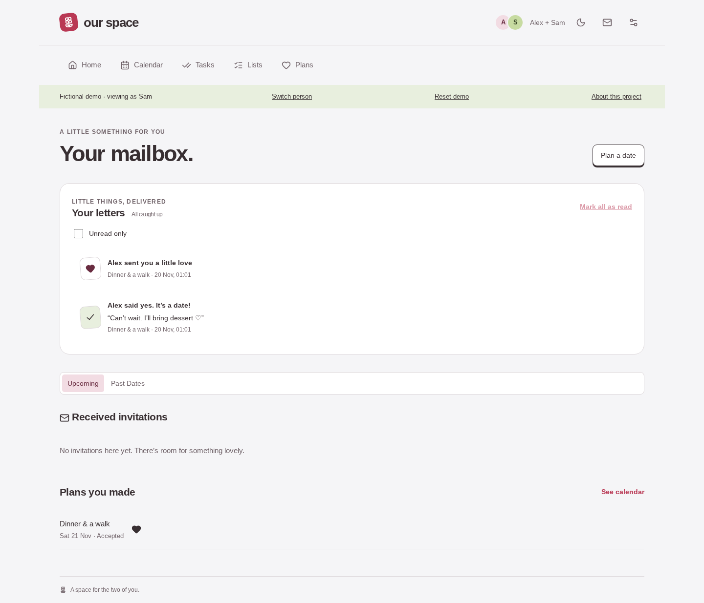
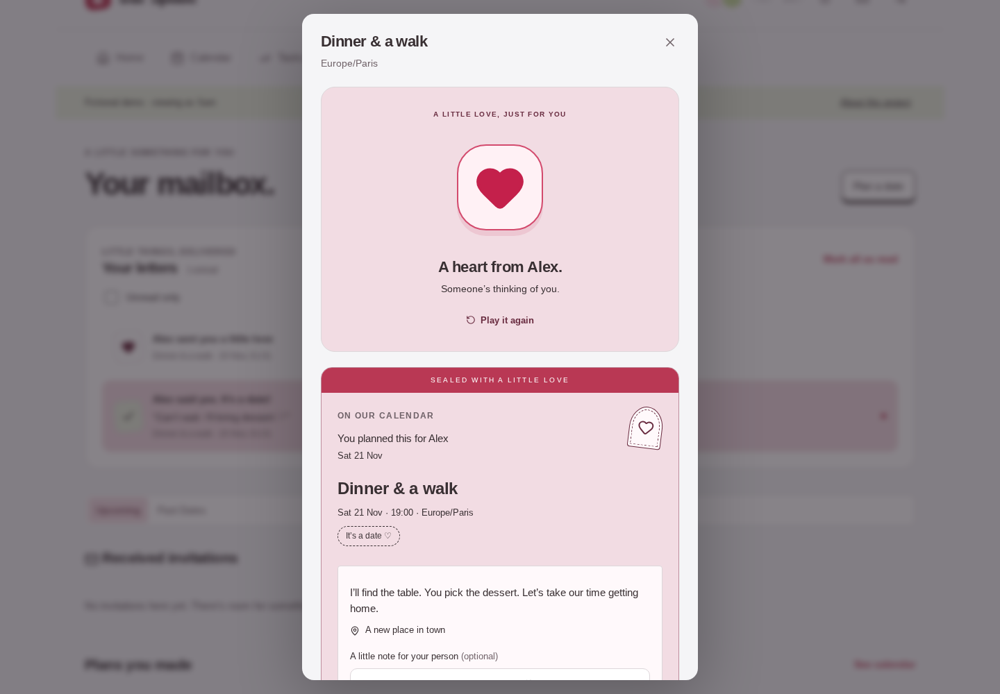
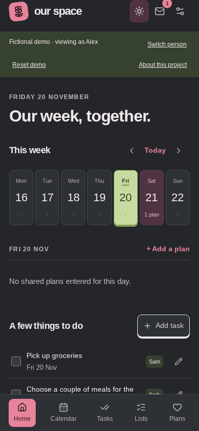

# Our Space

A shared planner for two people living together. Everyday routines, meals and groceries sit alongside date invitations, weekend plans and trips.

**[Explore the demo ↗](https://our-space-demo-pink.vercel.app/)** · **[Open the actual app ↗](https://our-space-swart.vercel.app/)**

The demo follows Alex and Sam, a fictional couple. No account is needed. Switch between both people to try invitations, replies, hearts and shared planning. Demo changes stay in your browser; it does not connect to the personal app’s database or send emails.

## Live app and account limits

The actual app requires an account and email confirmation. Each shared space supports **two people**: create your own space or join your partner’s through an invitation link. Registering does not grant access to other households.

This is a personal project hosted on free service plans. Signup emails and reminders are subject to provider quotas and rate limits, so delivery may be delayed or temporarily unavailable. For a quick look without registration, use the demo.

## Screenshots

All screenshots use fictional demo data.

### Shared calendar and date invitations

Mailbox and heart messages

Mobile night mode

## The idea

Most plans start in conversation. Our Space gives them somewhere to live afterwards: what needs doing this week, what to cook, and when to make time for each other. It keeps the shared parts of daily life together without requiring two complete personal schedules.

## Features

- **Shared calendar** — plans, availability, optional repeating events and surprise dates with hidden details.
- **Date invitations** — cherry, pistachio and midnight postcards, acceptance replies, little notes and animated hearts.
- **Mailbox** — invitations and replies with unread badges, persistent read status and replayable heart messages.
- **Tasks and lists** — shared or individual tasks, private tasks, recurring routines and grocery lists.
- **Meal planning** — a weekly menu with ingredients that can be added to groceries.
- **Trips** — dates, budgets, expenses, packing lists and itinerary notes.
- **Personal touches** — profile pictures, light and night themes, responsive layouts and reduced-motion support.
- **Email reminders** — optional daily summaries with a preferred local delivery hour in the connected app.

## Stack

| Layer | Technology |
| --- | --- |
| Interface | React, TypeScript, Vite, CSS |
| State and data | TanStack Query, Supabase Realtime |
| Interaction | Motion, Radix UI, Lucide icons |
| Backend | Supabase Auth, PostgreSQL, Row Level Security |
| Photos | Private Supabase Storage with expiring signed URLs |
| Reminders | Supabase Edge Functions, Cron, Brevo |
| Testing | Vitest, PGlite |
| Deployment | Vercel |

## A few implementation details

Notifications are created by database triggers alongside the activity they describe. Recipient-only access policies keep mailbox entries private, and repeated heart submissions do not create duplicate reactions. Surprise details are stored separately from the shared calendar entry until the organizer reveals them.

Profile pictures use private storage. The browser crops and re-encodes an image before uploading it, and the app displays it using a temporary signed link. Daily agenda emails list unfinished chores and today’s and tomorrow’s plans, with explicit empty-day messages. They omit your partner’s private tasks, invitation notes and hidden surprise details.

The public demo uses the same interface with fictional local data. Its build configuration prevents it from creating a Supabase client.
